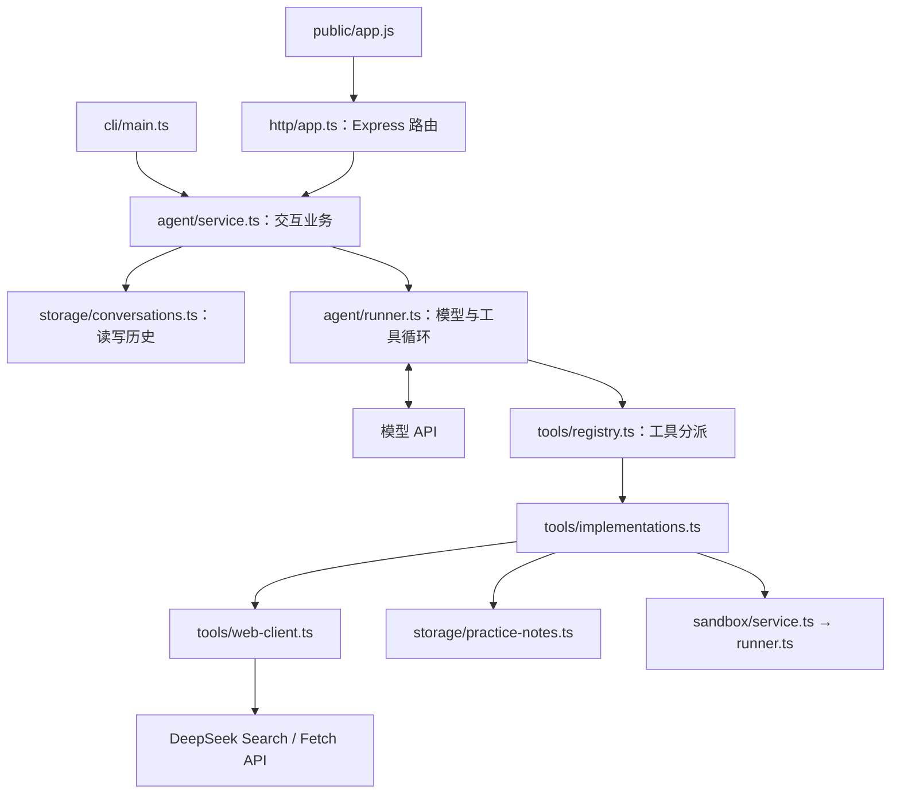

# Mini Agent：对照代码理解当前应用

更新日期：2026-10-23。本文以当前 Express 实现为准；`src/archive/` 仅供学习对照，不属于正式调用链。

## 1. 定位、目录与启动

这是个人 LeetCode 学习助手：整理原始思路、代码与卡点，保存和检索复习笔记。Python 工具供 Agent 在 debug 时按需运行代码、观察输出与异常；不是自动判题系统。

```text
src/
├── http/        # server.ts 监听端口，app.ts 路由与中间件
├── cli/         # main.ts 终端交互
├── agent/       # service.ts 一轮交互，runner.ts 模型循环，messages.ts 数据类型
├── tools/
│   ├── index.ts            # 唯一工具注册清单
│   ├── implementations.ts  # 工具描述、参数校验和实现入口
│   ├── registry.ts         # 通用工具分派
│   └── web-client.ts       # DeepSeek Search/Fetch 客户端，无本地缓存
├── sandbox/     # runner.ts Docker 执行，service.ts 校验与并发控制
├── storage/     # conversations.ts 会话，practice-notes.ts 刷题笔记
├── shared/      # errors.ts 业务错误
└── archive/     # 早期练习、旧 HTTP 服务和参考示例
public/          # 浏览器 HTML/CSS/JavaScript
test/            # 模拟回归、DOM/HTTP/存储测试、message-types.ts 类型约束
scripts/
└── web-smoke.mjs # 显式运行的真实联网接口检查
```

从项目根目录运行，需要支持直接运行 TypeScript 的 Node.js 环境：

```bash
npm install
# 在本地 .env 中配置 DEEPSEEK_API_KEY 和 DEEPSEEK_MODEL
npm start                 # http://127.0.0.1:3001/
npm run cli               # CLI，读取 .env
npm run cli -- 会话ID      # 打开指定会话
npm run typecheck
npm test
npm run test:web:live      # 真实 Search/Fetch 调用，会产生接口费用
```

Python 工具还需要本机 Docker 可用且已准备 `python:3.12-slim` 镜像。执行器使用 `--pull=never`，不会运行时自动拉取镜像。当前 package.json 没有 `agent` 或 `sandbox:demo` 脚本。

联网工具复用 `.env` 中的 `DEEPSEEK_API_KEY`，不需要额外搜索服务 Key。客户端位于 `src/tools/web-client.ts`，没有独立 `src/web/` 目录。

数据位于被 Git 忽略的 `data/conversations/`、`data/practice-notes/` 和 `data/exports/`。API 密钥留在服务端，不发给浏览器。

## 2. 从网页到模型的调用链



建议按 `public/app.js` → `src/http/app.ts` → `src/agent/service.ts` → `src/agent/runner.ts` → `src/tools/registry.ts` → 对应工具与存储的顺序走读。

| 文件 | 主要职责 | 关键入口 |
| --- | --- | --- |
| [src/http/server.ts](./src/http/server.ts) | 在 127.0.0.1:3001 启动服务 | `createExpressApp`、`listen` |
| [src/http/app.ts](./src/http/app.ts) | 路由、正文解析、错误映射、流事件和断连取消 | `createExpressApp` |
| [src/agent/service.ts](./src/agent/service.ts) | 历史、同会话互斥、调用模型、统计和追加 | `createAgentService`、`run` |
| [src/agent/runner.ts](./src/agent/runner.ts) | 消费模型流、工具循环、模型与工具测量 | `requestModel` |
| [src/tools/index.ts](./src/tools/index.ts) | 唯一工具注册清单 | `registeredTools` |
| [src/tools/registry.ts](./src/tools/registry.ts) | 名称查找、JSON 解析、错误封装 | `createToolRegistry`、`executeTool` |
| [src/tools/implementations.ts](./src/tools/implementations.ts) | 工具描述、参数校验和业务调用 | `create…Tool` |
| [src/tools/web-client.ts](./src/tools/web-client.ts) | 搜索与抓取 HTTP 请求、超时、响应校验和截断 | `createWebClient`、`search`、`readPage` |
| [src/storage/conversations.ts](./src/storage/conversations.ts) | 会话校验、读取、追加消息与更新元信息 | `loadConversation`、`appendMessages`、`updateConversationTitle` |
| [src/storage/practice-notes.ts](./src/storage/practice-notes.ts) | 笔记校验、增删改查和导出 | `PracticeNoteInput` |
| [src/sandbox/service.ts](./src/sandbox/service.ts) | HTTP/Agent 共用执行名额与清理失败闭锁 | `createSandboxService` |
| [src/sandbox/runner.ts](./src/sandbox/runner.ts) | Docker 生命周期、限制、超时与清理 | `runPythonSandbox` |

## 3. HTTP 与 CLI 入口

Express 负责 JSON 媒体类型检查、64 KiB 正文限制、JSON 解析和统一错误处理。业务层继续校验字符串长度、ID 和数据结构。

| 路径 | 方法 | 行为 |
| --- | --- | --- |
| `/health`、`/api/info` | GET / HEAD | 健康与服务信息 |
| `/api/echo` | POST | 基础正文校验示例 |
| `/api/conversations` | POST | 新建会话 |
| `/api/conversations/:id` | GET / HEAD | 读取完整会话 |
| `/api/agent/run` | POST | 一次性返回完整回复 |
| `/api/agent/stream` | POST | 网页使用的 NDJSON 流 |
| `/api/sandbox/run` | POST | 直接运行 Python，复用沙箱服务 |

请求格式不正确返回 400，正文过大 413，媒体类型不支持 415，已知路径的错误方法 405，未知路径 404。同会话忙碌返回 409。模型失败由 service 映射为 502，存储失败为 500。

`public/` 提供静态网页；Marked 和 DOMPurify 只通过两个指定 vendor 路径提供，不暴露整个 node_modules。

CLI 支持 `/history`、`/new`、`/exit`，同样调用 AgentService。它打印文本增量和工具结果，`/history` 仍只打印正文。网页停止按钮只接在流式入口，CLI 和非流式 HTTP 暂无对应取消操作。

## 4. 一次交互如何执行与保存

`AgentService.run` 按以下步骤执行：

1. 校验输入，检查取消信号，在当前服务实例的 `busy` 集合占用会话 ID。
2. 加载会话，将历史与当前用户输入转换为仅含 `role/content` 的模型输入。
3. 调用 runner，通过回调收集文本、工具记录和每次模型请求统计。
4. 确认回复非空，保存前再次检查取消信号。
5. 用 `appendMessages` 仅追加本轮用户消息和助手回复（含工具与统计），按需更新标题与最近会话指针，成功后返回。
6. 在 `finally` 中释放忙碌标记。

模型通过动态导入在需要时加载，因此创建/读取会话和注入模拟模型的测试不需要真实 API 密钥。

Node.js 的单线程不代表请求之间不会交错：等待模型的 `await` 期间，其他请求可以进入。`busy` 防止同实例内两个请求基于同一旧历史同时生成，导致消息顺序与上下文错配；两个进程各有自己的集合，不受同一把锁保护。

会话数据形状：

```ts
Conversation = { id, title, messages }
Message = UserMessage | AssistantMessage | SystemMessage
UserMessage = { role: 'user', content }
AssistantMessage = { role: 'assistant', content, toolCalls?, metrics? }
SystemMessage = { role: 'system', content }
ToolCallRecord = { name, argumentsJson, textOffset?, callId?, round?, durationMs?, status?, resultStatus? }
TurnMetrics = { durationMs, modelCalls, usage }
ModelCallRecord = { round, durationMs, usage }
TokenUsage = { inputTokens, outputTokens, totalTokens }
```

`role` 是 TypeScript 判别字段：用户和系统消息不能携带工具记录或模型统计；读取文件时也执行同样的运行时校验。

这些统计不作为模型协议消息回传。新格式中的消息可以没有 `toolCalls` 或 `metrics`；工具记录也可以只有名称与参数。这是字段兼容，不表示支持旧磁盘格式。

## 5. Agent Loop 与工具协议

runner 使用 OpenAI SDK 调用 DeepSeek Responses 接口，模型名来自环境变量。每次交互最多发起 5 次模型请求；SDK 自动重试关闭。

- `response.output_text.delta`：累积文本并通知界面。
- `response.completed`：读取完整 output 和 usage，记录本次模型耗时。
- `response.incomplete`、`response.failed`、流错误或没有 completed 就断开：报错，不把半轮回复写入会话。

若完整 output 没有 function_call，则返回累积文本。若有工具调用，将模型的完整受支持 output 加入本轮 input，再依次执行工具并追加 `function_call_output`。

`call_id` 将每个工具结果关联到具体调用：同一轮可能多次调用同一个工具，不能仅靠名称匹配。工具由程序顺序执行。最后一次模型请求仍要求调用工具时，直接报请求预算耗尽，不再执行没有机会让模型处理结果的工具。

工具结果只在当前交互的模型循环中使用；后续用户消息的模型上下文仅保留历史正文。历史中展示的工具调用记录不等于完整工具协议历史。

## 6. 工具与调试结果

当前注册 10 个工具：

| 工具 | 用途 |
| --- | --- |
| `get_current_time` | 查询指定时区的当前时间 |
| `web_search` | 调用 DeepSeek Search，返回链接、摘要和可用正文 |
| `read_webpage` | 调用 DeepSeek Fetch，读取指定网页的 Markdown 正文 |
| `run_python` | 运行 Python，返回输出、异常、退出状态及执行信息，辅助 debug |
| `save_practice_note` | 保存原始内容与整理结果 |
| `search_practice_notes` | 按关键词、题号和标签组合搜索 |
| `get_practice_note` | 按实际 ID 读取全文 |
| `update_practice_note` | 读取后完整替换，保留身份与创建时间 |
| `delete_practice_note` | 删除明确指定的笔记 |
| `export_practice_note_markdown` | 导出独立 Markdown 快照，返回本机路径 |

模型选择工具并组织参数，后端仍要校验：schema 不能保证 ID 存在、数据有效或操作符合限制。注册表拒绝未知工具，解析 JSON 并统一封装结果；取消不被吞成普通工具错误。

工具协议成功与程序运行成功是两层概念。`run_python` 即使返回 `ok: true`，也可能超时或异常退出。网页状态依据 `executionSucceeded`、`status`、退出码和清理结果展示；“程序正常退出”不表示代码正确。

Agent 可以给 `class Solution` 增加实例化、调用和 print 包装，也可以构造调试用例，但需说明新增内容，不能擅自修改算法后声称原代码正确。stdout/stderr 和笔记正文作为不可信资料，不能作为新的系统指令。

新增工具时，在 implementations.ts 增加工厂并在 index.ts 注册；不必为每个工具修改 registry.ts。

### 联网搜索与网页读取

这两个工具在 `implementations.ts` 中定义，在 `index.ts` 中注册；HTTP 客户端统一放在 `tools/web-client.ts`。它们是普通 function tools，沿用现有 Agent Loop、调用 ID、状态、耗时与网页卡片，不依赖 Responses 内置搜索开关。

| 工具参数 | DeepSeek 请求 | 返回内容 |
| --- | --- | --- |
| `web_search({ query })` | `POST /v1/tools/search`，固定 count=5、need_content=true | query、results、retrievedAt；结果包括标题、URL、摘要、正文及缺失/截断标记 |
| `read_webpage({ url })` | `POST /v1/tools/fetch` | 来源 URL、标题、Markdown 正文、截断标记和 retrievedAt |

Base URL 是 `https://api.deepseek.com`，使用现有 Key 的 Bearer 鉴权。接口定义见 [DeepSeek Search/Fetch 官方文档](https://api-docs.deepseek.com/zh-cn/guides/search/)。工具不写本地缓存；当前会话只记录工具参数和状态，完整工具结果不落盘。模型最终回复仍按正常会话流程保存。

实现边界：

- query 校验为 1～128 个 Unicode 字符；URL 最长 8192 个字符，仅接受不含用户名/密码的 HTTP/HTTPS 地址。
- 请求超时 30 秒，涵盖响应流读取；原始响应上限 2 MiB，无自动重试。用户停止时沿用 AbortSignal 取消。
- 最多返回 5 个结果，每项正文最多 8000 个 JS 字符、摘要最多 2000 个字符；独立网页正文最多 24000 个字符。返回对应截断标记，不能将截断内容当作全文。
- 搜索空数组是正常无结果；抓取正文为空、响应格式错误、HTTP 失败或超限作为工具错误返回；不向模型暴露服务端原始错误正文。
- 提示词要求仅有题号时搜索并核对题号/标题，必要时读取实际 URL；默认不读题解与讨论，按用户“只给提示”等要求回答。该约束是模型指令，不是服务端 URL 过滤器，搜索服务仍可能返回题解。
- 网页内容作为不可信资料；正文不完整或抓取失败时如实说明，不编造题干或来源。

Search/Fetch 按请求计费，与模型 Token 分开；当前不自动统计接口费用。检索内容回传模型后的输入 Token 则包含在正常模型 usage 中。

## 7. 笔记检索与持久化

笔记包括 `problem`、`original` 和 `summary`，后端生成 ID、创建时间与更新时间。用户原始代码与思路保持原样，整理结果单独保存。

搜索以关键词、题号、标签条件取交集，关键词不区分英文大小写，标签完整匹配；按更新时间降序返回，默认 10 条、最多 20 条，包含摘要和真实 ID。它是结构化笔记的关键词搜索，当前没有向量检索或长期记忆。

每个会话使用两个文件：

```text
data/conversations/conversation-<id>.meta.json  # version、id、title
data/conversations/conversation-<id>.jsonl      # 每行一条消息，无头部元信息
```

元信息示例：

```json
{"version":1,"id":"demo","title":"二分复习"}
```

消息文件示例（正文换行通过 JSON 转义，仍占一行）：

```jsonl
{"role":"user","content":"帮我分析这段代码\nprint(1)"}
{"role":"assistant","content":"先检查边界条件。"}
```

`initializeConversation` 排他创建空消息文件和元信息，已有同名文件时报错，不覆盖。`appendMessages(id, newMessages)` 校验历史和新增消息后，用 appendFile 将本轮新消息序列化为一批追加；不写回完整历史。`updateConversationTitle` 只原子替换小型元信息文件，最近会话指针也单独更新。CLI 启动只读取历史、更新指针，不会把已读取消息重新追加。

只读取新格式，不兼容或迁移此前的整文件 JSON、带头部元信息的 JSONL；旧文件保留。网页旧会话需重新新建；CLI 最近会话指针找不到新格式元信息时自动新建。

读取仍需加载完整历史供模型使用；追加前也校验现有文件。空 JSONL 是有效新会话；坏行或末尾缺少换行会明确报错并阻止继续追加，不自动丢弃尾部。工具位置与统计仍保存在助手消息行内。

追加一次写入两条消息不构成崩溃事务：异常中断可能留下半轮或截断行；此版本不做自动恢复、重试去重或跨进程写入协调。完整但仅有用户消息的半轮仍可能被读到，不能把 appendFile 描述为原子提交。消息追加、元信息更新与最近会话指针更新是独立操作，保存报错后应读取历史确认状态，不直接重发。

笔记仍保存为 JSON，并使用临时文件再 rename；会话消息文件不再使用整文件替换。

笔记更新尚无版本冲突检查，保存尚无幂等去重。Markdown 导出在 `data/exports/` 生成快照，网页没有下载接口；删除原笔记不会删除导出快照。

## 8. Python 执行与取消

正式执行器通过无 shell 的 `spawn` 调用 Docker，固定 Python 镜像，不挂载宿主目录。配置禁网、只读根文件系统、非 root 用户、移除 capabilities 和 no-new-privileges；代码 32 KiB、stdin 16 KiB、输出合计 64 KiB，执行阶段 3 秒，内存 128 MiB、CPU 0.5、PID 32。基础设施命令另有超时。

同进程 HTTP 和 Agent 共用一个沙箱服务，一次接受一个任务。执行结果区分 completed、timeout、output_limit、cancelled、infrastructure_error；completed 仍需看退出码。结束前清理容器，清理失败则闭锁后续任务，不能提前释放名额继续执行。

网页停止按钮中止 fetch；HTTP 监听未正常结束的响应断连，将 AbortSignal 传给 service、runner、SDK、工具与沙箱。取消后不再进入后续模型请求或工具调用。

杀掉 Docker 客户端不保证容器结束，因此执行器还会用独立超时运行 `docker rm --force`；不复用已经取消的信号。创建阶段先等待创建请求结束再清理，避免先删后建。

取消前已完成的笔记写入、删除或导出不会回滚。会话保存开始前取消则不保存本轮；保存已开始则等待写入完成。网页保留部分文本并重新读取历史核对状态，无法确认时提示稍后刷新。失败或取消的轮次目前没有独立审计日志。

## 9. 网页流与每轮统计

网页 POST `/api/agent/stream`，按 NDJSON 逐行解析。网络块不等于事件，TextDecoder 与缓冲区处理中文 UTF-8 和 JSON 拆包。

| 事件 | 内容与时机 |
| --- | --- |
| `delta` | 文本增量；约每 40 ms 合并渲染一次 Markdown |
| `model` | 一次模型请求完整结束后的轮次、耗时和 usage |
| `tool` | 工具执行结束后的名称、参数、完整输出，以及调用 ID、轮次、状态、耗时 |
| `done` | 会话保存成功后的最终正文、工具记录和汇总统计 |
| `error` | 流开始后的错误；尚未发送内容时使用 HTTP 错误状态与 JSON |

网页按实际执行顺序展示“本轮模型文字 → 工具卡片 → 下一轮模型文字”，不再显示独立执行面板或模型轮次分组。工具卡片在执行结束后显示，可展开参数及当次结果；尚无工具开始事件或运行中计时。回复末尾只显示总耗时与输入/输出/总 Token，逐次模型统计仍保存但不单独展示。

统计口径：

- 模型耗时：发起请求至完整消费模型响应流，不包含随后工具执行。
- 工具耗时：调用执行器至返回结果，Python 工具包含其基础设施和清理等待。
- 本次回复总耗时：service 开始调用 runner 至拿到有效回复，不含读取历史、会话写盘和浏览器网络时间；不是两个耗时字段的严格求和。
- Token：使用每次 API 响应的 input_tokens、output_tokens、total_tokens，汇总所有请求。多轮请求重发历史产生的输入用量也累计，不去重，也不按字符估计。
- 任意请求没有提供完整 usage，本次回复总 Token 显示“未提供”；其他请求已知的 usage 仍保存在 metrics.modelCalls 中，但网页不单独展示。Token 属于模型请求，不人为分摊到工具。

工具记录的 textOffset 是工具执行前累计输出的 JavaScript 字符串长度（UTF-16 代码单元），用于将正文按位置切开并插入工具卡片。多个连续工具可以使用同一位置。刷新后恢复相同的正文/工具顺序，以及名称、参数、调用 ID、状态、耗时和总用量；完整工具输出仅在流式执行时展示，不落盘。旧记录没有位置时保留正文在前、工具在后，不猜测分段；缺失统计也不反推历史 Token 或运行时间。

只有成功完成的交互保存上述统计；工具失败后模型继续解释并完成回复时，该工具失败状态仍会保存。整轮失败或取消时，已显示事件只暂留在当前页面，刷新后不恢复。

浏览器会话列表只记录当前浏览器打开过的最多 50 个会话，不是服务器全部会话目录。助手 Markdown 经 DOMPurify 清理，用户正文与工具参数/结果通过纯文本展示。

## 10. 验证与下一步

`npm run typecheck` 检查类型；`npm test` 使用模拟模型、临时存储、本机 HTTP、DOM 和模拟 Docker 子进程验证工程行为，不调用付费模型，也不证明真实模型决策质量或真实容器隔离能力。

重点测试入口：

- `test/agent.test.mjs`：SDK 流解析、工具协议、预算、取消、usage、工具状态与模拟搜索→抓取→回答链路。
- `test/web-tools.test.mjs`：联网参数校验、请求映射、无缓存、空结果、截断、错误、大小限制、取消与超时。
- `test/message-types.ts`：由 typecheck 验证角色收窄和助手专有字段限制。
- `test/session.test.mjs`：元信息分离、消息追加、文件不替换和截断保护。
- `test/tool-history.test.mjs`：历史兼容、统计累加、缺失用量、校验和元数据不回传模型。
- `test/stream.test.mjs`：流事件与保存后的 done。
- `test/frontend-stream.test.mjs`：拆包、取消、文字/工具交错显示、刷新恢复和工具内容安全。
- `test/cancellation.test.mjs`、`test/sandbox-reference.test.mjs`：取消传播与模拟容器清理。
- `test/practice-notes.test.mjs`、`test/practice-note-tools.test.mjs`：笔记存储与工具闭环。

真实接口检查单独运行 `npm run test:web:live`，不包含在 `npm test` 中。脚本通过工具注册表测试第 1、20、1234 题，不调用对话模型，不保存网页内容。`matched` 表示搜索是否返回期望题目的描述页；若未命中，用已知官方 URL 单独检查 Fetch，标记 `urlSource: "known-fixture"`。`passed` 与退出码主要检查请求和正文特征，不代表所有题号搜索都定位成功，应同时检查 matched。

2026-10-23 本次会话中的真实接口观察（不是全量评测）：

| 题号 | 搜索直接命中描述页 | Fetch 检查 | URL 来源 |
| --- | --- | --- | --- |
| 1，两数之和 | 否 | 成功，含题目相关内容、示例和约束关键词，未截断 | 已知官方测试链接 |
| 20，有效的括号 | 是 | 成功，含题目相关内容、示例和约束关键词，未截断 | 搜索返回的 classic 描述页 |
| 1234，替换子串得到平衡字符串 | 否（返回对应题解等结果） | 成功，含题目相关内容、示例和约束关键词，未截断 | 已知官方测试链接 |

仅凭题号搜索仍可能返回题解、题单或无关内容；上述检查没有证明真实模型能自主找到每道题，也不代表所有页面均可抓取。

下一步优先建立固定真实模型任务集，再完善调试记录与笔记关联、上下文压缩与记忆、SQLite 检索，具体验收见 [TODO.md](./TODO.md)。
