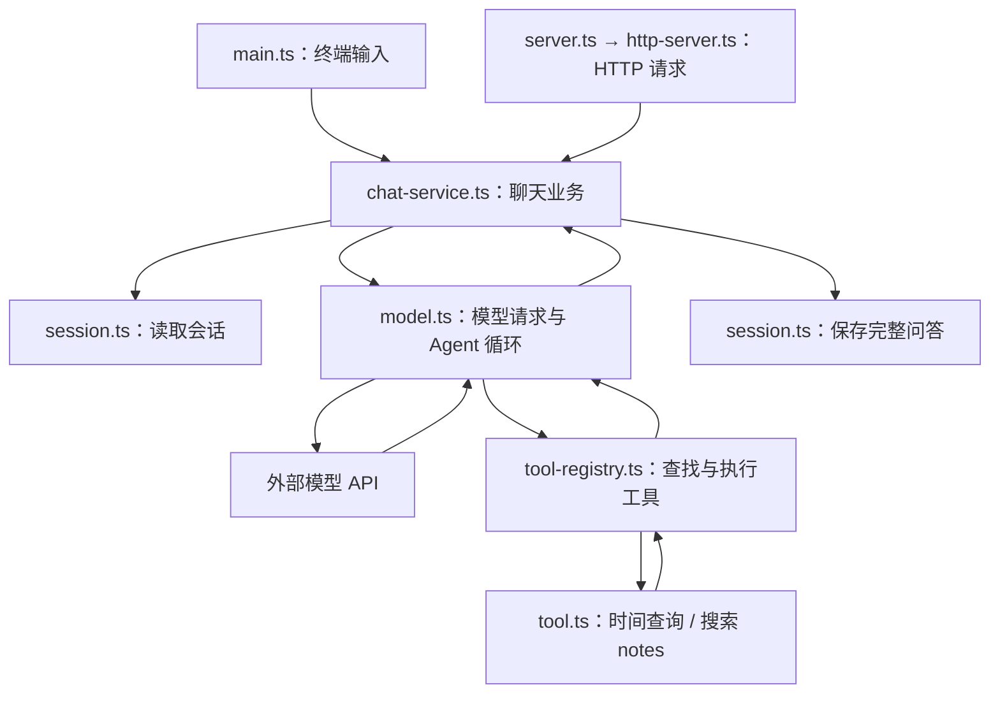

# Mini FastGPT：对照代码理解整个应用

更新日期：2026-10-20。本文记录当前实现，不包含尚未完成的网页、向量检索和取消生成。

阅读时可以在编辑器里同时打开本文和对应文件。建议顺序：`main.ts` → `http-server.ts` → `chat-service.ts` → `model.ts` → `tool-registry.ts` → `tool.ts` → `session.ts`。

## 1. 我们已经做出了什么

这是一个面向本地技术笔记的 AI 助手。用户可以通过终端或 HTTP 接口发起多轮聊天。模型需要外部信息时，可以请求本地程序查询时间、搜索笔记；程序将工具结果交还模型，由模型组织回答。成功的一轮问答保存在 JSON 文件中。

目前两个入口的显示方式不同：

- 终端：模型生成一段，就显示一段；工具执行完后显示工具记录。
- HTTP：等待整轮完成并保存后，一次性返回 JSON。

模型端的流式请求已经实现，但它不等于浏览器端的流式传输也已实现。



## 2. 每个文件负责什么

| 文件 | 主要职责 | 重点函数或类型 |
| --- | --- | --- |
| [lesson/main.ts](./lesson/main.ts) | 读取键盘输入、处理终端命令、打印流式内容 | `main` |
| [lesson/server.ts](./lesson/server.ts) | 创建 HTTP 服务并监听端口 | `createApiServer` 的调用、`listen` |
| [lesson/http-server.ts](./lesson/http-server.ts) | 路由、正文解析、HTTP 响应和错误转换 | `createApiServer`、`handle`、`readJsonBody`、`sendJson` |
| [lesson/chat-service.ts](./lesson/chat-service.ts) | 创建/读取会话、组织一轮聊天、并发控制 | `createChatService`、`chat` |
| [lesson/model.ts](./lesson/model.ts) | 调用模型、消费流、处理工具调用循环 | `requestModel` |
| [lesson/tool-registry.ts](./lesson/tool-registry.ts) | 根据名字分派工具，统一封装执行结果 | `createToolRegistry`、`executeTool` |
| [lesson/tool.ts](./lesson/tool.ts) | 工具描述、参数校验、时间和搜索实现 | `registeredTools`、`searchNotes` |
| [lesson/session.ts](./lesson/session.ts) | 会话结构验证、磁盘读取与保存 | `loadConversation`、`saveConversation` |
| [lesson/messages.ts](./lesson/messages.ts) | 消息类型与早期练习的数组辅助函数 | `Message`、`formatMessages` |
| [lesson/errors.ts](./lesson/errors.ts) | 带状态码和业务错误码的异常 | `AppError` |

`lesson/archive/` 是早期练习，不在当前聊天调用链中。`server.ts` 前面保留的注释也是旧练习，实际执行的是文件底部的启动代码。

## 3. 先理解程序传递的数据

`messages.ts` 定义一条消息：

```ts
type Message = {
    role: 'user' | 'assistant' | 'system';
    content: string;
};
```

对应你熟悉的 Python，可以想成一个包含 `role` 和 `content` 的字典。不过 TypeScript 类型只在检查代码时提供约束，不会自动验证外部 JSON。

`session.ts` 定义一个会话：

```ts
type Conversation = {
    id: string;
    title: string;
    messages: Message[];
};
```

例如：

```json
{
  "id": "example-session",
  "title": "什么是 Promise",
  "messages": [
    { "role": "user", "content": "什么是 Promise？" },
    { "role": "assistant", "content": "Promise 表示一个异步操作的最终结果。" }
  ]
}
```

`conversationId` 决定读取哪个历史文件；`messages` 给模型提供上下文。模型不会仅凭本地会话 ID 就自动知道以前说过什么。

## 4. 入口一：终端如何启动和聊天

对应 [main.ts](./lesson/main.ts)。

从项目根目录启动：

```bash
node --env-file=.env lesson/main.ts
```

`.env` 需要配置 `DEEPSEEK_API_KEY` 和 `DEEPSEEK_MODEL`，不要把密钥提交到仓库。

`main()` 首先创建一个聊天服务：

```ts
const service = createChatService();
```

随后确定当前会话：

1. 有命令行参数：通过 `service.getConversation(requestedId)` 读取指定会话。
2. 没有参数：通过 `loadLastConversation()` 读取最近会话。
3. 首次运行没有最近会话指针时，创建一个新会话对象。
4. `await saveConversation(conversation)` 保存当前会话并更新最近会话指针，然后才开始交互。

可以这样恢复指定会话：

```bash
node --env-file=.env lesson/main.ts <会话ID>
```

`createInterface` 连接标准输入和输出，`terminal.question()` 返回 Promise。`await` 等待输入时暂停当前异步函数，Node 仍可以处理其他事件。

循环先处理特殊命令：

| 输入 | 行为 |
| --- | --- |
| 空字符串 | 跳过 |
| `/exit` | 跳出循环 |
| `/history` | 重新从磁盘读取当前会话，再格式化显示 |
| `/new` | 通过 service 创建并保存新会话，成功后切换 |
| 其他文字 | 当作普通聊天消息 |

普通消息传给：

```ts
const result = await service.chat(conversation.id, input, {
    onChunk: (text) => { stdout.write(text); },
    onTool: (name, argumentsJson, output) => {
        // 实际代码在这里打印工具名称、参数和结果。
    }
});
conversation = result.conversation;
```

这里两个回调是终端传给业务层的“显示动作”。业务层知道何时有文本和工具结果，但不需要自己读取键盘或操作 `stdout`。这样 HTTP 才能复用同一套业务逻辑。

即使失败，内层 `finally` 也会补换行；退出循环时，外层 `finally` 关闭终端接口。聊天成功时已经保存，退出时不需要再次保存旧内存对象。

## 5. 入口二：HTTP 请求如何进入应用

对应 [server.ts](./lesson/server.ts) 和 [http-server.ts](./lesson/http-server.ts)。

```bash
node --env-file=.env lesson/server.ts
```

`server.ts` 调用 `createApiServer()` 得到服务器对象，然后监听 `127.0.0.1:3000`。构造服务器和监听端口分开，方便测试时传入模拟服务或使用其他端口。

`createApiServer()` 默认创建一个聊天服务实例。所有到达这个服务器的请求共用它，尤其共用它内部的忙碌集合。

每来一个请求，Node 调用 `createServer` 的回调，传入：

- `req`：请求方法、URL、headers，以及逐块到达的正文。
- `res`：用于设置状态码、响应头和返回内容的对象。

回调启动 `handle(req, res)`，并为它的 Promise 安装 `.catch(...)`。前面的 `void` 表示这里不使用 Promise 返回值；真正处理异步错误的是 `.catch`。

### 5.1 路由选择

`handle` 先取出 URL 的 `pathname`，再依次匹配路径。匹配成功的分支处理完后 `return`，不再执行后面的 404。

| 方法和路径 | 请求内容 | 成功响应 |
| --- | --- | --- |
| `GET /health` | 无 | 200，`{ status: "ok" }` |
| `GET /api/info` | 无 | 200，名称与版本 |
| `POST /api/echo` | `{ message }` | 200，`{ received }` |
| `POST /api/conversations` | `{}` 或 `{ title }` | 201，会话对象 |
| `GET /api/conversations/:id` | URL 中的会话 ID | 200，会话对象及历史 |
| `POST /api/chat` | `{ conversationId, message }` | 200，`{ conversationId, reply }` |

已知路径使用错误方法返回 405，并设置 `Allow`。不存在的路径返回 404。`/api/conversations/:id` 使用正则提取 ID，再用 `decodeURIComponent` 解码，编码非法时返回 400。

### 5.2 正文从字节变成对象

`readJsonBody(req)` 做四件事：

1. 检查媒体类型是 `application/json`，允许附带 `charset`；否则 415。
2. 用 `for await` 读取请求正文的各个 Buffer 块。
3. 累加实际字节数，超过 `64 * 1024` 返回 413，不只信任请求头声明的大小。
4. 合并 Buffer、按 UTF-8 解码，再 `JSON.parse`；解析失败返回 400。

先合并 Buffer 再解码，可以处理一个中文字的 UTF-8 字节被拆到不同块里的情况。正文大小限制按字节计算，和字符串的 `.length` 不同。

读取使用 `req.iterator({ destroyOnReturn: false })`。超限时 `req.resume()` 让剩余正文被消费，随后抛错，避免迭代提前退出立即销毁流，妨碍返回错误响应。

函数返回 `unknown`，因为合法 JSON 也可能是数字、数组或 `null`。路由还需要验证它是对象、字段存在且类型正确；service 再验证标题、消息长度和会话 ID 等业务规则。

## 6. 两个入口汇合：一轮聊天的业务流程

对应 [chat-service.ts](./lesson/chat-service.ts) 的 `createChatService()`。

它返回三个函数：

```ts
return { newConversation, getConversation, chat };
```

这些函数通过闭包共享 `directory`、`runModel` 和 `busy`。可以把它理解为：工厂函数创建了一组操作，以及这些操作共同使用的内部状态。

`newConversation` 验证标题、生成 UUID、保存空会话；`getConversation` 验证 ID 并读取文件。缺失文件转换成 404，损坏文件等读取错误转换成 500。

`chat(conversationId, message, callbacks)` 的执行顺序如下：

1. **校验消息。** 必须是字符串，trim 后长度为 1～10000。这里的长度使用 JavaScript 字符串 `.length`。
2. **检查并加锁。** `busy.has(id)` 为真则抛 409，否则立即 `busy.add(id)`。
3. **读取最新历史。** 调用 `getConversation`，不依赖调用者缓存的旧对象。
4. **构造模型输入。** 创建用户消息，并 `structuredClone([...conversation.messages, userMessage])` 得到独立输入。
5. **等待模型。** 调用 `runModel`，把文本和工具回调传下去。
6. **检查成功结果。** 模型调用失败或返回空白文本，抛 502，不保存这一轮。
7. **追加完整问答。** 将 user 和 assistant 两条消息加入会话。标题仍为“新会话”时，取本次问题前 30 个字符串单位作为标题。
8. **等待保存。** 保存失败抛 500，不能向调用者报告聊天已成功保存。
9. **返回结果。** 返回 `{ conversationId, reply, conversation }`。
10. **释放锁。** 无论成功或失败，`finally` 中都会 `busy.delete(id)`。

第 4 步只构造输入，还没有把用户问题保存到磁盘。这样模型失败时，历史不会多出一个没有有效回答的半轮消息。

### 6.1 并发保护为什么有效

假设同一会话的请求 A 和 B 同时到达：

```text
A：检查 busy → 加入 busy → await 读取文件
B：检查 busy → 已存在 → 返回 409
A：生成 → 保存 → finally 移除 busy
```

检查和加入之间没有 `await`，在当前 Node 执行流程中，这段同步代码不会在中途让出执行权。不同会话的 ID 不同，可以同时进行。

这是一种拒绝冲突请求的机制，不会自动排队。集合只属于一个服务实例：不同进程、不同实例，或者同时运行的 CLI 和 HTTP，不能靠它互相协调。

### 6.2 为什么模型是延迟导入的

默认 `runModel` 在真正聊天时才执行：

```ts
const { requestModel } = await import('./model.ts');
```

因此创建会话、查看历史和健康检查不需要先初始化模型客户端。测试也可以传入 `runModel` 和临时 `directory`，模拟模型并隔离数据，不使用真实密钥或历史。

## 7. 模型如何流式返回内容

对应 [model.ts](./lesson/model.ts)。

模块首次加载时读取 `DEEPSEEK_API_KEY`，创建 OpenAI SDK 客户端，配置当前代码使用的 DeepSeek 地址、60 秒超时及 `maxRetries: 0`。`requestModel` 每次调用还会读取 `DEEPSEEK_MODEL`。

这些是本项目当前代码配置；本文没有独立验证供应商接口的最新兼容性。

`requestModel` 把历史转成 `ResponseInput`，随后最多进行 5 次模型请求。每次发送：

- 模型名称和完整的当前输入。
- 工具描述列表 `toolDefinitions`。
- 关于时间查询、搜索笔记、引用来源和工具文本处理的 instructions。
- `tool_choice: 'auto'`、`stream: true`。
- 当前代码配置的 `max_output_tokens: 512` 和 `reasoning: { effort: 'none' }`。

`client.responses.create(...)` 返回异步事件流，程序用 `for await` 消费。

| 事件 | 本地处理 |
| --- | --- |
| `response.output_text.delta` | 将片段追加到 `content`，并调用 `onChunk` |
| `response.completed` | 保存完整 response，后面检查它的 output |
| `response.incomplete` | 抛错，不保存不完整回答 |
| `response.failed` 或 `error` | 抛错 |
| 流结束但没收到 completed | 视为连接提前结束，抛错 |

`onChunk?.(event.delta)` 中的 `?.` 表示回调存在才调用。CLI 提供回调，HTTP 当前没有提供。

`content` 放在循环外，因此会累积本轮所有模型请求的文本片段，最终保存的可能包括工具调用前后的文字。工具执行结果本身不会直接作为聊天正文追加，模型会根据它生成文本。

## 8. 工具调用：模型提出请求，程序执行函数

流完整结束后，程序从 `completedResponse.output` 筛选 `function_call`。

如果没有工具调用：检查累积文本非空，返回 `content`，交给 service 保存。

如果有工具调用，流程如下：

```text
模型：请求 search_notes，arguments = {"query":"Promise"}
  ↓
程序：executeTool("search_notes", arguments)
  ↓
本地：读取 notes 下的 Markdown，返回匹配片段
  ↓
程序：追加 function_call_output，绑定原来的 call_id
  ↓
再次请求模型：带上历史、本次模型输出、工具结果
  ↓
模型：根据检索片段组织回答
```

发给模型的工具描述不是函数源码。模型只返回“调用什么、参数是什么”；真正的文件读取、时间查询发生在本机。

### 8.1 为什么要带回完整 output 和 call_id

程序先将模型的 message、reasoning、function_call 输出项追加到当前 `input`，随后为每个工具追加：

```ts
{
    type: 'function_call_output',
    call_id: call.call_id,
    output
}
```

`call_id` 把结果和某一次调用对应起来。仅有工具名称不够，因为同一工具可能被调用多次。

当前实现每次重新发送累积输入，不使用 `previous_response_id`。遇到未支持的 output 类型会抛错，不静默丢弃。

多个工具按 `for...of` 顺序执行，每个执行完后调用 `onTool`。现在的工具回调表示“执行结束”，没有单独的开始事件。

最多 5 次限制的是本轮模型请求数，不是工具总数。第五次仍要求工具时，程序直接报错，不再执行工具，因为已没有下一次模型请求来处理结果。

### 8.2 注册表怎样代替大量 if

对应 [tool-registry.ts](./lesson/tool-registry.ts) 和 `tool.ts` 的 `registeredTools`。

每个工具包含：

```ts
{
    definition: /* 给模型看的名称、描述和参数结构 */,
    execute: /* 本地真正执行的函数 */
}
```

注册时用 Map 保存 `name → tool`，名称重复立即报错。执行时统一走：

```text
查找名称 → JSON.parse(arguments) → 工具自己的参数校验
        → await tool.execute(args) → JSON.stringify(结果)
```

成功输出带 `ok: true`；未知工具、坏 JSON、参数错误或执行失败，统一变成 `{ ok: false, error: ... }` 的 JSON 字符串。

工具失败通常不会立刻终止整轮聊天：错误结果会送给模型，让它修正参数或解释失败。模型接口本身失败则由外层转换成 502。

新增工具时，在列表加入描述和执行函数即可，不需要修改通用分派器。

## 9. 当前两个工具具体做什么

对应 [tool.ts](./lesson/tool.ts)。

### 时间工具

`get_current_time` 需要一个非空字符串 `timezone`。本地使用 `Intl.DateTimeFormat` 按时区格式化本机当前时间。时区无效时抛错，再由注册表转换成失败结果。

### 笔记搜索

`search_notes` 需要一个非空字符串 `query`。执行顺序：

1. trim 关键词并转为小写用于匹配。
2. 枚举 `notes/` 下的普通 `.md` 文件，按文件名排序。
3. 逐个读取文件，按行首二级标题 `## ` 分段。
4. 对每段提取 `heading` 和正文 `text`；文件开头的介绍也参与搜索。
5. 判断标题加正文是否包含关键词，英文忽略大小写。
6. 返回最多 5 个 `{ file, heading, text }`。

```json
{
  "query": "Promise",
  "matches": [
    {
      "file": "example.md",
      "heading": "Promise",
      "text": "这里是匹配章节的原文。"
    }
  ]
}
```

上面是结构示例，不是实际文件的查询结果。执行器还会给最终工具结果加上 `ok: true`。

没有匹配时返回空数组，是一次成功执行。读取文件失败则是工具错误。

这里是字面关键词检索，没有 embedding 或语义排序。前 5 条由遍历顺序决定；分段也尚未处理代码块里的二级标题。引用要求目前通过提示词表达，还没有程序化核验引用或来源点击功能。

## 10. 会话怎样持久化和恢复

对应 [session.ts](./lesson/session.ts)。

默认路径通过 `new URL('../data/', import.meta.url)` 定位到代码旁的目录，不随启动命令的工作目录随意变化。

```text
data/
├── conversation_<id>.json
└── last-session.txt
```

`conversation_<id>.json` 保存完整会话；`last-session.txt` 保存最近一次成功更新指针的会话 ID，供 CLI 恢复使用。

读取流程：

```text
验证 ID → readFile → JSON.parse
       → validateConversation 验证结构 → 返回会话
```

`validateConversation` 不只检查 JSON 是否能解析，还检查 ID 与目标一致、标题是字符串、消息数组中的 role/content 合法。TypeScript 类型不能代替这一步运行时校验。

最近会话指针不存在时才自动创建新会话；已有指针指向缺失文件、文件损坏等情况继续报错，避免误当空历史。

保存流程：

```text
验证 ID 和会话结构
  → 创建目录
  → 会话 JSON 写到随机临时文件
  → rename 替换正式会话文件
  → 同样方式更新 last-session.txt
```

`finally` 尝试清理临时文件。先写临时文件再替换，减少直接覆盖时留下半段 JSON 的风险。

两个文件不是一个事务：可能会话已经替换成功，但最近会话指针更新失败。因此 service 的保存错误提示要求读取历史确认状态，不能简单宣称“报错就完全没保存”。这套实现也没有提供数据库事务或断电持久性保证。

跨轮保存的只有用户消息和助手正文。本轮内部的工具调用、工具结果和 reasoning 没有写入会话文件。

## 11. 成功和失败最后怎样返回给用户

成功时，`requestModel` 返回文本，service 保存会话后返回 `ChatResult`：

- CLI 更新当前会话变量；文本此前已经通过回调逐段显示。
- HTTP 取出 `conversationId` 和 `reply`，通过 `sendJson` 返回 200。

`sendJson` 设置 JSON UTF-8 响应头并结束响应；如果连接已经销毁或响应已结束，就不再写入。

HTTP 入口统一捕获异常：

| 状态码 | 当前典型情况 |
| --- | --- |
| 400 | JSON、字段、会话 ID 或消息内容不合法 |
| 404 | 路由或会话不存在 |
| 405 | 方法不支持 |
| 409 | 同一服务实例内该会话正在聊天 |
| 413 | 正文超过 64 KiB |
| 415 | 正文媒体类型不是 JSON |
| 500 | 文件读取、保存失败，或未分类内部异常 |
| 502 | 模型失败、流不完整、空回复或超过请求次数上限 |

`AppError` 保留预设的 status/code/message；其他异常对外统一返回 `INTERNAL_ERROR`，不直接暴露内部异常细节。

```json
{
  "error": {
    "code": "CONVERSATION_BUSY",
    "message": "当前会话正忙"
  }
}
```

终端已经展示部分文本后仍可能遇到流失败，此时会显示失败提示，但该轮不写入历史。显示过的文字和成功持久化的记录是两个不同阶段。

HTTP 客户端断开目前也不会自动取消模型任务。服务器设置了请求/请求头接收超时，但它们不能代替整个 Agent 生成流程的取消机制。

## 12. 用一个实际问题串起全部流程

假设已有会话 `id`，用户问：“我的笔记里怎样解释 Promise？”

1. CLI 读取问题，或 HTTP 路由从 JSON 中取出 `conversationId` 和 `message`。
2. service 校验消息，标记会话忙碌，读取磁盘历史。
3. service 构造“旧历史 + 当前问题”，调用模型。
4. 模型可能请求 `search_notes`，参数为 `{"query":"Promise"}`。
5. 注册表查到工具、解析参数并执行，搜索本地 Markdown。
6. 程序把原始模型输出与对应的工具结果追加到本轮输入。
7. 再次请求模型，模型依据片段生成带文件名/章节的回答。
8. CLI 通过回调逐段显示；HTTP 此时仍等待。
9. 模型完整结束且有有效文本，service 追加一轮问答、保存、释放忙碌标记。
10. CLI 更新会话对象；HTTP 返回完整 JSON。
11. 用户继续追问时，再从保存的历史开始下一轮。

步骤 4 的调用选择由模型决定，不是固定规则分支；示例说明一条预期路径，不能保证每次生成完全相同。

## 13. 怎样验证当前实现

从项目根目录运行：

```bash
npm run typecheck
node --test test/*.test.mjs
```

本次整理时两条命令通过，测试运行器报告 3 个测试文件通过。

| 已保存的测试文件 | 主要验证内容 |
| --- | --- |
| `test/agent.test.mjs` | 模拟模型流、普通回答、工具调用、参数修正、轮数上限及异常 |
| `test/tool-registry.test.mjs` | 同步/异步工具分派、不同参数结构、重复工具名 |
| `test/session.test.mjs` | 会话保存加载、切换、损坏数据及写入失败 |

此前还做过临时的 service 并发/失败验证、正文解析和模拟路由检查；这些不是已经保存进测试目录的长期回归测试。用户已通过 curl 验证聊天及历史。最近路由修改的验证是模拟请求，因环境不允许监听端口，没有重新做真实 HTTP 网络验证。

测试中的模拟模型不等同于真实供应商接口验证，也不需要调用付费模型。

## 14. 后续从哪里接着做

第一阶段的后端已经完成。下一步是第二阶段的第一个小练习：

```text
HTML 输入框 → 点击按钮 → 浏览器 fetch /api/echo → 页面展示返回值
```

之后将 echo 换成创建会话和聊天接口，再添加消息列表、等待状态、错误提示、流式文本与工具事件、会话恢复、取消生成。

这些新入口可以继续使用 `chat-service.ts`。它不依赖终端显示方式，这正是我们先抽出共享业务层的实际收益。
